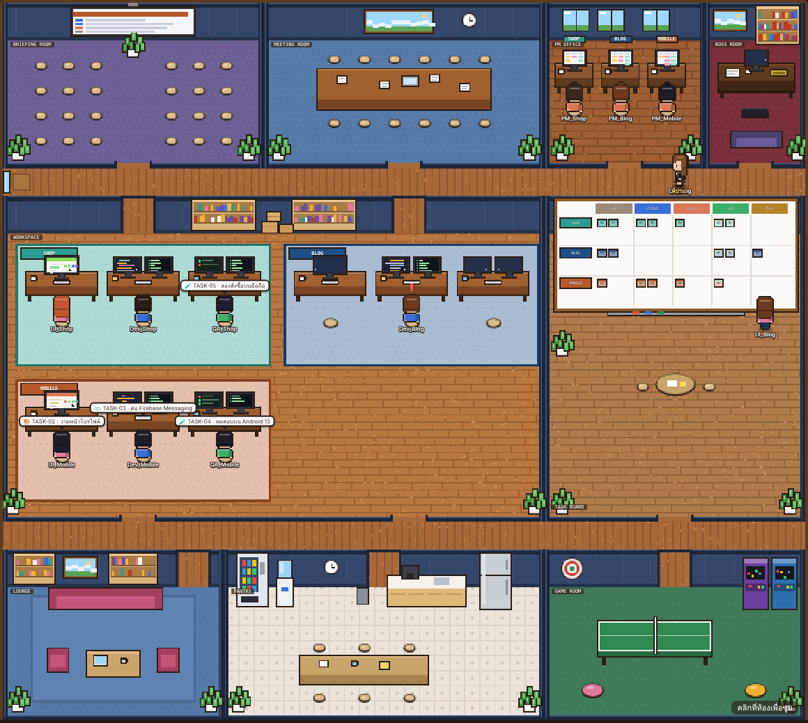
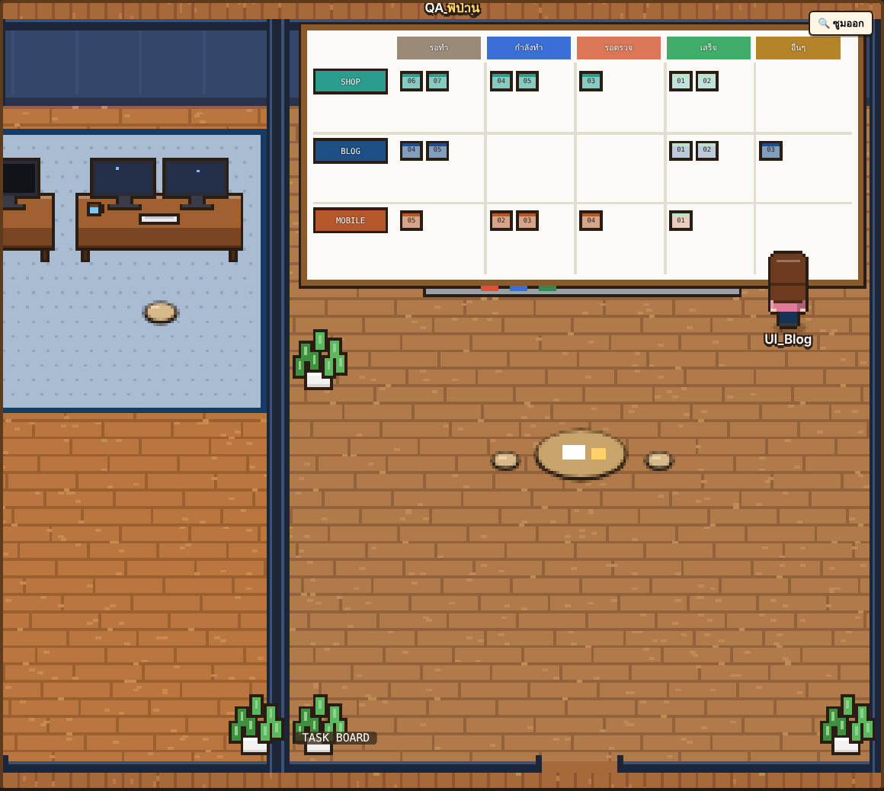
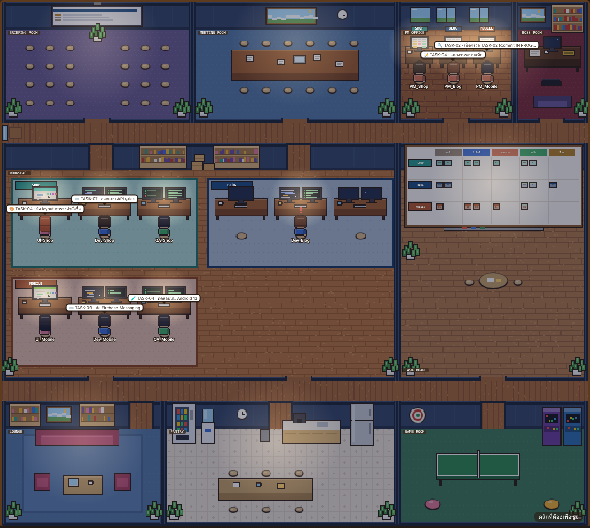
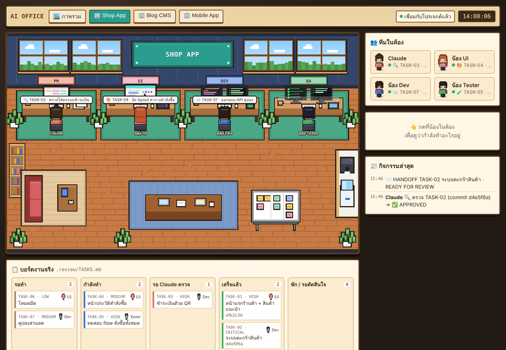

# 🏢 AI Office

**A live pixel-art office for your AI coding agents.**

🎮 **Live demo:** https://thagoose3.github.io/AI-Office/ (example teams, no install)
Each agent (PM, UI, Dev, QA) is a little character that sits at its desk while it works, walks to the task board when a new task arrives, grabs coffee when idle, chats with other teams, and celebrates in the meeting room when a task is done — all driven by the real status of your projects.

ออฟฟิศพิกเซลที่โชว์ว่าทีม AI ของคุณกำลังทำอะไรอยู่จริงๆ น้องแต่ละตัวนั่งทำงานเมื่อมีงาน เดินไปดูบอร์ดเมื่องานใหม่เข้า ว่างก็ไปชงกาแฟ คุยข้ามทีม และไปฉลองที่ห้องประชุมเมื่องานเสร็จ



---

## ✨ Features

- **One office, many projects** — every project gets its own team pod (`Dev_Shop`, `UI_Blog`, …) in a shared office with a briefing room, meeting room, PM office, boss room, task board, lounge, pantry and game room.
- **Driven by real files** — reads `.review/TASKS.md`, `REVIEW.md`, `HANDOFF.md`, `TEST_REPORT.md`, `git log` and small per-agent status files. No database, no API keys.
- **Live task board** — a big kanban on the wall (To do / Doing / In review / Done) for every team; click a room to zoom in.
- **Believable behaviour** — pathfinding that respects walls and doors, cross-team chats, making coffee for a colleague and delivering it, lunch at noon, going home in the evening, real-time day/night lighting.
- **Notifications without sound** — a bouncing ❗ above the agent, toast banners and a flashing roster when a task arrives or finishes.
- **พี่ป่าน, the boss** — walks around checking on every team, asks how tasks are going, and agents answer with their real progress.
- **Zero dependencies** — a single `server.js` (Node.js built-ins only) + a single `office.html`.

| Task board (zoomed) | Night mode | Single room view |
|---|---|---|
|  |  |  |

---

## 🚀 Quick start

```bash
git clone https://github.com/<you>/ai-office.git
cd ai-office
node server.js
# open http://localhost:3010
```

On Windows just double-click **`AIOffice.bat`** (and `CreateDesktopShortcut.bat` once for a desktop icon).

Without a `projects.json` the office runs the **demo** in `example/` (3 sample teams).

---

### 🌐 Static demo (GitHub Pages)

`index.html` → `office.html`. When the page isn't served from localhost, it answers `/api/*` from `demo/*.json` (a snapshot of the `example/` teams) instead of the server. To refresh the snapshot: run `node server.js`, then save `/api/projects` → `demo/projects.json` and `/api/state?p=<id>` → `demo/state-<id>.json`. Add `?demo` to force it locally.

## 🔌 Connect your own projects

1. Copy `projects.example.json` → `projects.json` and point it at your projects:
   ```json
   [
     { "id": "shop", "name": "Shop App", "root": "C:\\Work\\shop-app", "theme": "wood", "short": "Shop" }
   ]
   ```
   `theme`: `wood` · `sky` · `mint` · `night` — `projects.json` is git-ignored.
2. Copy `template/.office` and `template/.review` into each project and fill in `.office/roles/project.md`.
3. Tell your agents to keep their status file up to date (the role files already say so):
   ```json
   {"agent":"dev","state":"working","task":"TASK-03","doing":"Add coupon API","progress":40,"updated":"2026-11-06T14:45:00+07:00"}
   ```
   `state`: `working` · `designing` · `testing` · `planning` · `reviewing` · `blocked` · `idle`

Tasks in `TASKS.md` look like:
```
## TASK-07 [HIGH] Coupon codes — สถานะ: TODO
ผู้รับผิดชอบ: dev
```

### Suggested workflow (what the templates are written for)
```
You → PM (Claude) → "คำสั่งจาก PM" → lead chat (Antigravity) → dev / ui / tester sub-agents → HANDOFF → PM reviews
```
Any agent that can read/write files works — the office only watches the files.

📖 Full guide (Thai): [คู่มือการเชื่อม.md](คู่มือการเชื่อม.md)

---

## 📁 Files

| | |
|---|---|
| `server.js` | Tiny read-only HTTP server: `/api/projects`, `/api/state?p=<id>` |
| `office.html` | The whole office (canvas rendering, sprites, behaviour) |
| `projects.example.json`, `example/` | Demo data |
| `template/` | Role files + empty `.review/` to copy into your projects |
| `AIOffice.bat`, `CreateDesktopShortcut.bat`, `AIOffice.ico` | Windows launcher & desktop icon |

All art is drawn in code — no external image assets.

## License

MIT
